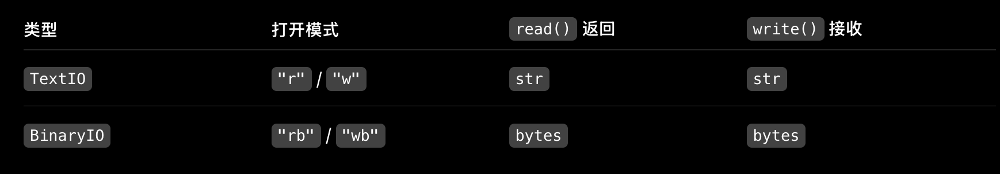
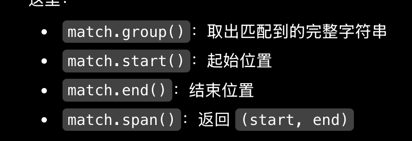

# Tokenization

## BPE training example

### Dataset

读取数据

- 需要注意`BinaryIO`和`TextIO`的区别，这里用到的是BinaryIO
- 

### Vocabulary

初始字典：256个byte加上一个special token `<|endoftext|>`

### Pre-Tokenization

通过regex进行pre-tokenization

- 输入一段长文本
- 输出字典frequency table`dict[tuple[bytes, ....], int]` 用python的`bytes`类

```Python
{low: 5, lower: 2, widest: 3, newest: 6}
```

**tie breaker: 按照字典序**

- 细节：PAT需要用r代表raw string来避免转义

#### 可以并行

首先进行chunking来分块成进程个数，方便后续处理，这里注意分块边界需要找到special split token

通过`<|endoftext|>` 进行chunking然后并行pre-tokenize

用到了`multiprocessing`库，教程如下

```Python
import multiprocessing as mp


def square(x: int) -> int:
    return x * x


def main() -> None:
    numbers = [1, 2, 3, 4, 5]

    with mp.Pool(processes=4) as pool:
        results = pool.map(square, numbers)

    print(results)


if __name__ == "__main__":
    main()
```

task格式：`(path_to_dataset, start, end, special_tokens)`

用一个`pre_tokenize_unit`函数来map这个tasks

- 将special tokens转换为regex pattern（用`|`连接）
- 通过`re.finditer`找到special token
- 把前面的文本chunk找出来
- 对chunk运用PAT进行pre-tokenization
- 返回一个频率表

#### 去掉 special tokens

一开始split并为special token预留id然后把它扔掉进行tokenization

- `re.split`
- `"|".join(special_tokens)`
- `re.escape`
- ```Python

  print(re.escape('https://www.python.org'))

  legal_chars = string.ascii_lowercase + string.digits + "!#$%&'*+-.^_`|~:"
  print('[%s]+' % re.escape(legal_chars))

  operators = ['+', '-', '*', '/', '**']
  print('|'.join(map(re.escape, sorted(operators, reverse=True))))
  ```

#### Merges

通过frequency table找出需要被合并的pair

最终输出一个`dict[bytes, int]

#### 优化
